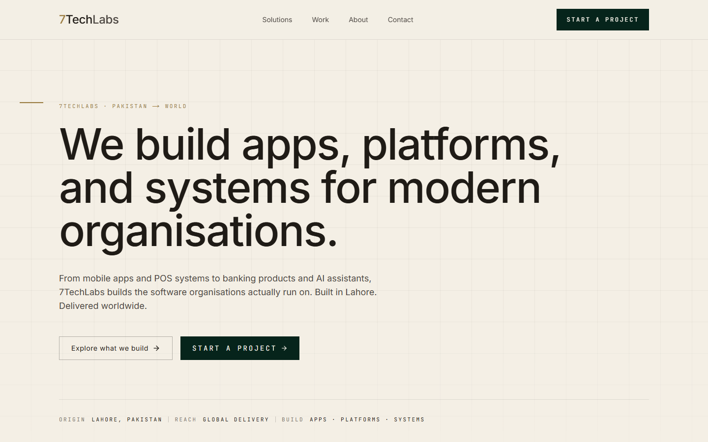
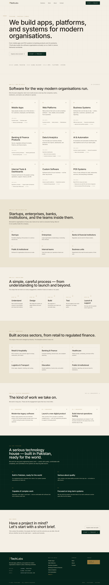
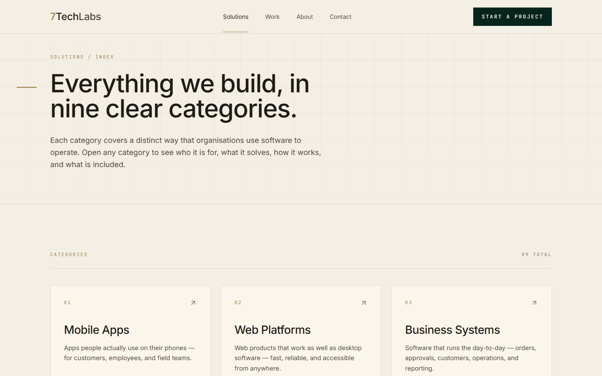
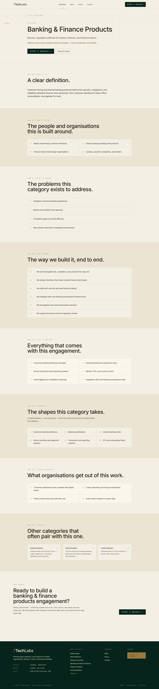
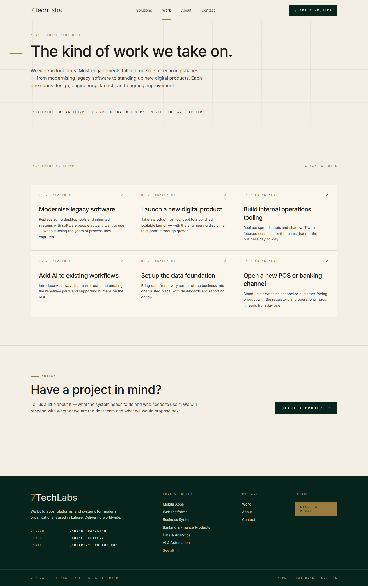
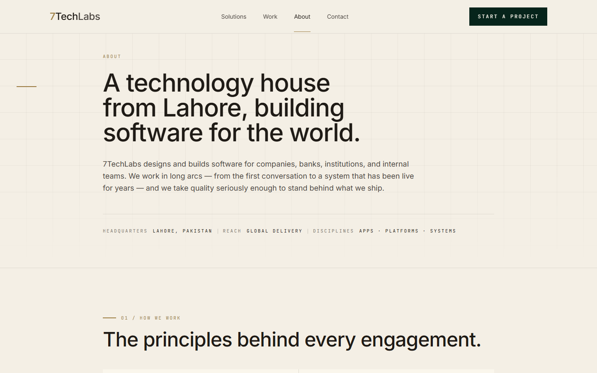
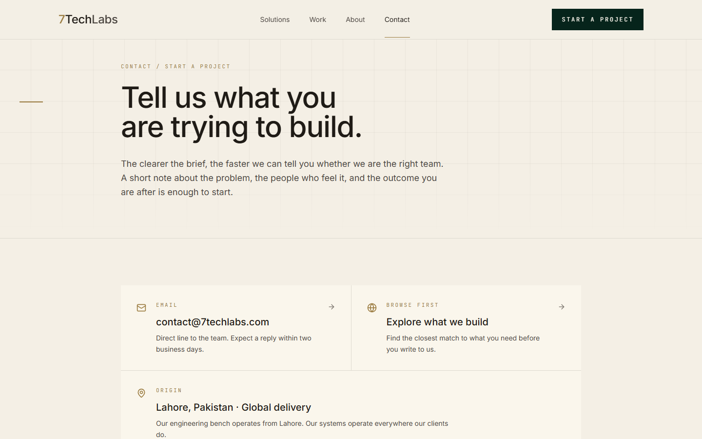
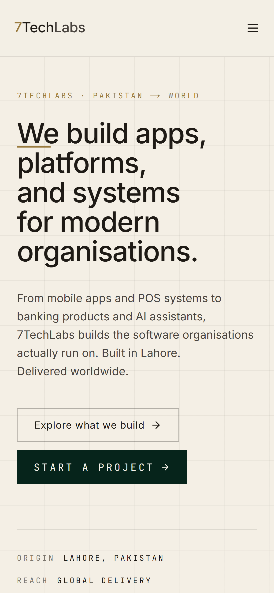
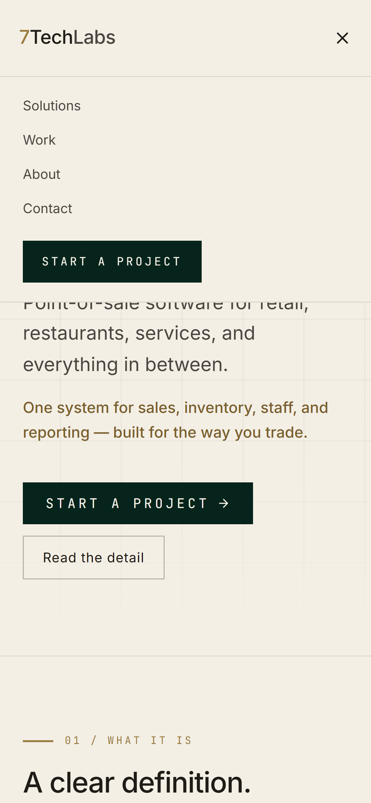
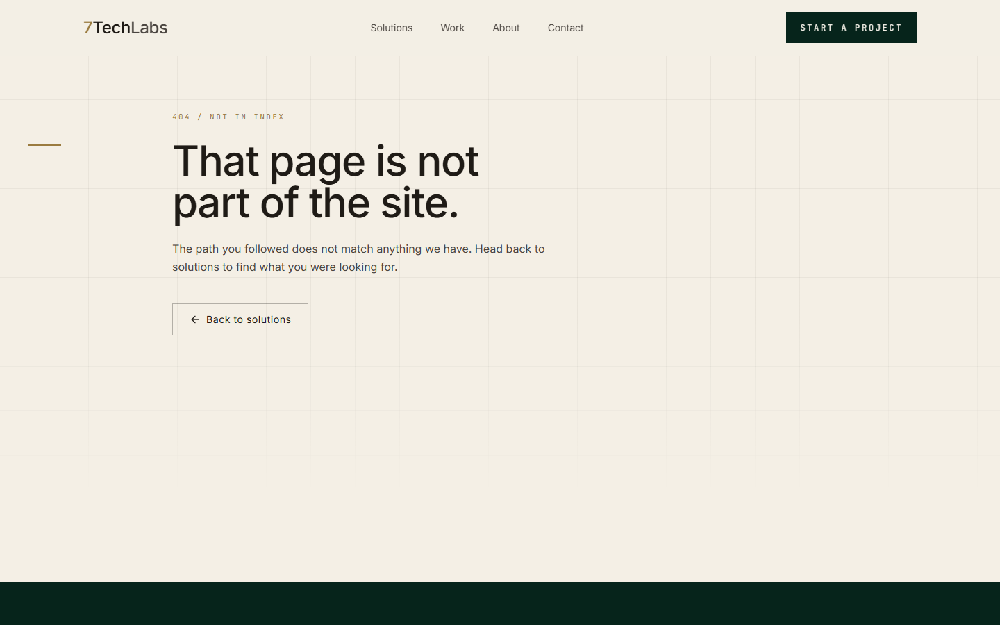

# 7TechLabs studio site

The public website for 7TechLabs, a software studio in Lahore that builds apps, platforms and
business systems for clients in Pakistan and abroad. A buyer needs to work out in a minute or two
whether the studio builds the kind of thing they need, and then start a conversation. The site is
built around that: nine service categories, each with its own page that answers who it is for,
what it fixes and how the work runs.

I designed and built it end to end: the editorial visual system, the content model that drives
every service page from one data file, the page layouts, the motion, the phone layout and the
Vercel deployment.



## What it does

**For prospective clients**
- A home page that walks from the pitch to nine solution cards, "Who we build for", a five-step
  process (Understand, Design, Build, Test, Launch & support), six industries, three of the
  engagement types, four "Why 7TechLabs" statements and a closing call to action
- A solutions index and nine solution pages: Mobile Apps, Web Platforms, Business Systems,
  Banking & Finance Products, Data & Analytics, AI & Automation, Internal Tools & Dashboards,
  Custom Software and POS Systems
- Every solution page has the same eight numbered sections: What it is, Who it is for, What it
  solves, How it works, What is included, Examples, Typical outcomes and Related, followed by a
  call to action named for that category
- A Work page that describes six engagement archetypes (modernise legacy software, launch a new
  product, build internal tooling, add AI to workflows, set up the data foundation, open a new
  POS or banking channel)
- About and Contact pages, with a `mailto:` contact link and a reply-time promise; a custom 404
- "Start a project" is in the header on every page and in a strip at the foot of most pages

**For the studio**
- All service copy lives in `src/data/solutions.ts`. Adding a tenth service is one object in an
  array: the index card, the detail page, its metadata and the "Related" links all follow
- No CMS, no database, no API keys and no environment variables to manage

## How the site is built

**One content model, many pages.** `solutions.ts` exports a typed `Solution` record (`slug`,
`title`, `oneLine`, `benefit`, `whatItIs`, and arrays for `whoItsFor`, `whatItSolves`,
`howItWorks`, `whatsIncluded`, `outcomes`, `examples` and `related`). The same file exports the
audiences, industries, process steps, engagement archetypes and "why" statements used on the
home, Work and About pages. Pages are layouts; the words are data.

**Static generation.** `solutions/[slug]/page.tsx` uses `generateStaticParams()` to pre-render
all nine solution pages at build time, and `generateMetadata()` gives each its own title and
description from the same record. An unknown slug returns `notFound()` and the custom 404.
`related` holds slugs, which are resolved against the list and filtered, so a stale slug drops
out instead of breaking the page.

**A design system in Tailwind tokens.** `tailwind.config.ts` defines the whole palette as named
tokens: ivory surfaces (`canvas`, `paper`, `parchment`), a bottle green for emphasis, a brass
accent, four ink weights for text on light, three cream weights for text on dark, and hairline
`rule` colours. Inter carries the text and JetBrains Mono the small uppercase labels, both loaded
through `next/font` with `display: swap`. A 64px architectural grid (`grid-mesh`) sits behind the
page heroes, faded out with a CSS mask.

**Motion that stays out of the way.** Route changes go through `PageTransition`: a Framer Motion
`AnimatePresence` keyed on the path, a 12px rise over 450ms on one shared easing curve
(`cubic-bezier(0.32, 0.72, 0, 1)`), and a scroll-to-top on every route. If the visitor prefers
reduced motion, the transition is skipped entirely and a global CSS rule cuts every other
animation and transition to 0.01ms.

**Phone layout.** Below the `md` breakpoint the header collapses to a menu button with a full
panel of links and the call to action; the call-to-action buttons have a 44px minimum height. The page is
clamped against stray horizontal scroll, and anchors are offset by `scroll-padding-top` so they
clear the fixed 80px header.

## Stack

| Layer | Choice |
|---|---|
| Framework | Next.js 16 (App Router), React 19, TypeScript 5 |
| Styling | Tailwind CSS 3.4 with a custom token palette |
| Motion | Framer Motion 12 |
| Icons | lucide-react |
| Fonts | Inter and JetBrains Mono via `next/font` |
| Content | Typed data in `src/data/solutions.ts`, no CMS |
| Hosting | Vercel |

## Engineering

- 9 solution pages pre-rendered from one data file, plus 5 top-level routes and a 404
- 14 shared components in `src/components/`
- Strict TypeScript with the `@/` path alias; no client-side data fetching
- No tests or CI in this repo; the site is deployed on Vercel

## Screenshots

| | |
|---|---|
|  |  |
| The full home page | Solutions index: nine categories |
|  |  |
| A solution page and its eight sections | Work: six engagement archetypes |
|  |  |
| About | Contact |
|  |  |
| Home on a phone | Phone menu open on a solution page |
|  | |
| Custom 404 | |

All screenshots show the site running locally with the copy that ships in the repo. There is no
dark mode.

## Running it locally

```bash
git clone https://github.com/ashhhadd-210/7techlabs.git
cd 7techlabs
npm install
npm run dev          # http://localhost:3000
```

For a production build: `npm run build && npm start`. There are no environment variables, keys
or external services. On one Windows machine Turbopack served a 404 for every route; if that
happens, `npx next dev --webpack` runs the same app with the webpack bundler.
